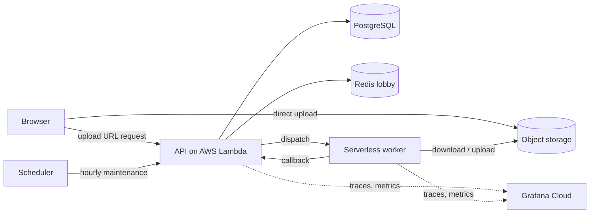

# VidCensor


[](https://github.com/astral-sh/ruff)


[](https://github.com/pre-commit/pre-commit)


VidCensor is a full-stack, automated video sanitization platform designed to automatically detect and censor (mute or beep) profanity in the audio track of video files **without re-encoding the video stream**. This preserves video quality and significantly speeds up the process compared to full video re-rendering.

It started as a local, GPU-accelerated MVP and has grown into a platform that **runs end to end in a serverless cloud staging environment**: a video uploaded in the browser is transcribed, censored, and returned for download, on infrastructure that is created and destroyed entirely from code.


## Project Status

| Stage | Outcome |
| :--- | :--- |
| **MVP** | Local GPU pipeline: upload, transcribe, censor, remux without touching the video stream. |
| **Production-minded backend** | Fully async API, observability (traces, metrics, structured logs), integration tests against real containers, automated releases. |
| **Smarter product** | Multilingual auto-detection, user-defined censor lists, queue with admission control, hybrid rate limiting, privacy purge. |
| **Scalable architecture** | Direct-to-storage uploads, a worker that runs either on a local GPU or serverless, runtime-configured frontend. |
| **Infrastructure as code** | The whole stack described in Terraform and Terragrunt across several providers, deployed by pipelines. |
| **Cloud staging, end to end** | **Live and working:** upload in the UI, processed by the serverless worker, censored result downloaded. |
| **Hardening and validation** | Secretless runtime, least-privilege roles, private internal routes, and a checkpoint-based verification of every change on the real environment. |
| **Next** | Production environment, tighter CI trust boundaries, cost guardrails, GPU worker. |

### Headline Numbers (measured on the live staging environment)

| Metric | Result |
| :--- | :--- |
| **Short clip, end to end** | Uploaded, transcribed, censored and downloadable in **about a minute** |
| **API cold start** | **About 3 seconds**, and the API **scales to zero** (no idle compute cost) |
| **Deploy** | Full multi-provider stack, migrations and smoke test in **about 6 minutes** |
| **Teardown** | Whole environment destroyed in **about 4 minutes** |
| **Infrastructure** | **9 infrastructure units across 6 providers**, plus the serverless worker |
| **Quality** | **196 tests, ~98% coverage** (95% enforced in CI) |

> The staging worker currently runs **CPU-only** to stay within a free tier; the code is **GPU-ready** and a switch away from running on T4 GPUs.


## Features

* **Full-Stack Web App:** Drag-and-drop UI for uploading videos and tracking status.
* **Direct-to-Storage Uploads:** Files go straight to object storage via short-lived presigned URLs, bypassing the API server. This reduces server load and scales cleanly, with multi-tier size guardrails.
* **GPU Acceleration:** Uses NVIDIA CUDA to transcribe audio at lightning speeds.
* **Hybrid Worker Architecture:** The same pipeline runs on a local GPU worker (Celery, Docker) or on a serverless worker (Modal) with a single configuration switch.
* **Smart Multilingual Support:**
    * **Auto-Language Detection:** Identifies the spoken language and loads the matching profanity dictionary.
    * **Dynamic Filtering:** Only censors words relevant to the detected language, avoiding false positives.
    * **Unicode-Aware Sanitization:** Handles accented and international characters.
* **Custom Censor List:** Users add their own words through a chip-style input; they are merged with the global dictionary at runtime.
* **Queue with Admission Control:** Uploads wait in a lobby that promotes live users as capacity frees up, with heartbeat checks, a watchdog for stuck tasks, and abandoned-task cleanup.
* **Hybrid Rate Limiting:** Dual-key limits per guest and per IP, backed by Redis, protect the infrastructure from abuse.
* **Privacy Purge and Maintenance Mode:** One-click deletion of processed files, and an admin switch that pauses new uploads while running tasks finish.
* **High-Concurrency Backend:** **FastAPI Async** architecture handles many concurrent requests without blocking.
* **No Re-Encoding:** Preserves original video quality by only manipulating the audio stream.
* **Scheduled Cleanup:** Retention policies run on a schedule in the cloud, with a storage-level lifecycle rule as a fail-safe.
* **Runtime Configuration:** The frontend fetches its operating limits from the backend at startup, so one build runs unchanged in every environment.
* **Security Guardrails:**
    * **Frontend (UX):** "Fail-Fast" validation rejects oversized files or videos that are too long before uploading.
    * **Backend (Security):** Verifies size and content type before issuing an upload URL, then checks the real object size after upload.
* **Full Observability Stack:**
    * **Application:** Distributed tracing and request metrics, locally (Jaeger, Prometheus) and in the cloud (Grafana).
    * **Infrastructure:** **cAdvisor** monitors raw container CPU/RAM usage to detect bottlenecks.


## Demo (Turn on the volume from the options below to listen the censored words)

https://github.com/user-attachments/assets/57611c05-e25a-43e7-8022-354394ccd971

## System Architecture

### Local (Docker Compose)

The application runs as a set of Docker containers orchestrated by `docker-compose`:

| Service | Technology | Description |
| :--- | :--- | :--- |
| **Frontend** | Vue.js + Vite | Modern web UI for uploads and monitoring (dev server and Nginx production build). |
| **Backend** | FastAPI | REST API managing tasks, uploads, and downloads. |
| **Worker** | Celery + PyTorch | GPU-enabled worker running AI tasks and FFmpeg. |
| **Beat** | Celery Beat | Scheduler container for periodic tasks. |
| **Migrations** | Alembic | One-shot container that applies database migrations on startup. |
| **Broker** | Redis | Message broker for task queues and the admission lobby. |
| **Database** | PostgreSQL | Persists task metadata and status. |
| **Storage** | Floci + Floci UI | S3-compatible local AWS emulator with a web console. |
| **Telemetry** | OTel, Jaeger, Prometheus, Grafana | Monitoring: logs, traces and metrics. |
| **Infra Monitor** | cAdvisor | Real-time container resource usage (CPU/RAM/Net). |

### Cloud (Staging)

The same code runs serverless, with each concern on a managed platform:

| Concern | Platform |
| :--- | :--- |
| **API** | AWS Lambda (container image, via the Lambda Web Adapter) behind Amazon API Gateway |
| **Worker** | Modal (serverless, GPU-ready) |
| **Database** | Supabase (PostgreSQL) |
| **Queue / Cache** | Upstash (Redis) |
| **Object Storage** | Cloudflare R2 |
| **Frontend** | Vercel |
| **Telemetry** | Grafana Cloud (traces, metrics) via OpenTelemetry |
| **Scheduling** | AWS EventBridge Scheduler |
| **Delivery** | GitHub Actions, Terraform and Terragrunt |




## Prerequisites

To run the GPU-accelerated stack, your host machine needs the following:

### 1. Hardware
* **NVIDIA GPU:** Compute Capability 3.5+ (Recommended: 6GB+ VRAM).
* **RAM:** 16GB+ recommended.

### 2. Software
* **Docker Engine** & **Docker Compose (v2)**
* **NVIDIA Drivers:** Install the latest drivers for your GPU.
* **NVIDIA Container Toolkit:** This is **required** for Docker to access your GPU.
* **just** (optional): a command runner for the common tasks listed below.

### 3. Infrastructure (IaC) Tools
Only needed if you work on the cloud infrastructure:
* **tfenv** (Terraform version manager) and **tgenv** (Terragrunt version manager)
* **tflint** (Terraform linter, required by the pre-commit hooks)

#### Installing NVIDIA Container Toolkit (Linux/WSL2)
```bash
# 1. Configure the production repository
curl -fsSL https://nvidia.github.io/libnvidia-container/gpgkey | sudo gpg --dearmor -o /usr/share/keyrings/nvidia-container-toolkit-keyring.gpg \
  && curl -s -L https://nvidia.github.io/libnvidia-container/stable/deb/nvidia-container-toolkit.list | \
  sed 's#deb https://#deb [signed-by=/usr/share/keyrings/nvidia-container-toolkit-keyring.gpg] https://#g' | \
  sudo tee /etc/apt/sources.list.d/nvidia-container-toolkit.list

# 2. Install the toolkit
sudo apt-get update
sudo apt-get install -y nvidia-container-toolkit

# 3. Configure Docker to use the toolkit
sudo nvidia-ctk runtime configure --runtime=docker
sudo systemctl restart docker
```

* Validate by running below command on the terminal

```
nvidia-smi
```

* should show output similar to what is shown below

```
Wed Dec 17 06:20:38 2025
+-----------------------------------------------------------------------------------------+
| NVIDIA-SMI 575.57.04              Driver Version: 576.52         CUDA Version: 12.9     |
|-----------------------------------------+------------------------+----------------------+
| GPU  Name                 Persistence-M | Bus-Id          Disp.A | Volatile Uncorr. ECC |
| Fan  Temp   Perf          Pwr:Usage/Cap |           Memory-Usage | GPU-Util  Compute M. |
|                                         |                        |               MIG M. |
|=========================================+========================+======================|
|   0  NVIDIA GeForce RTX 4070 ...    On  |   00000000:01:00.0 Off |                  N/A |
| N/A   43C    P0             18W /  100W |       0MiB /   8188MiB |      0%      Default |
|                                         |                        |                  N/A |
+-----------------------------------------+------------------------+----------------------+

+-----------------------------------------------------------------------------------------+
| Processes:                                                                              |
|  GPU   GI   CI              PID   Type   Process name                        GPU Memory |
|        ID   ID                                                               Usage      |
|=========================================================================================|
|  No running processes found                                                             |
+-----------------------------------------------------------------------------------------+
```


## Directory Structure

```text
VidCensor/
├── .github/workflows/                  # CI, build, deploy, plan, destroy & changelog pipelines
├── backend/                            # FastAPI & worker Python code
│   ├── app/
│   │   ├── api/                        # API route endpoints
│   │   ├── worker/                     # Hybrid worker (local Celery / serverless)
│   │   ├── core/                       # Configuration, logging, telemetry
│   │   └── s3.py                       # S3 client logic
│   ├── vidcensor/                      # Core censoring library
│   ├── tests/                          # Test suite (95% coverage enforced)
│   │   ├── integration/                # API/DB/Worker tests with Testcontainers
│   │   ├── unit/                       # Services, routers, config, worker
│   │   └── vidcensor/                  # Unit tests (pure logic)
│   ├── pyproject.toml                  # Poetry dependency management
│   └── poetry.lock                     # Locked dependencies
├── docs/                               # Architecture documentation
├── frontend/                           # Vue.js application
├── infra/                              # Infrastructure as code (Terraform & Terragrunt)
├── scripts/                            # Bootstrap, migration & deployment scripts
├── telemetry/                          # Observability as code (dashboards, collector, scrape config)
├── docker-compose.yml                  # Orchestration for all local services
├── Dockerfile                          # Lean API image (local)
├── Dockerfile.light                    # Cloud API image
├── Dockerfile.worker                   # Heavy GPU worker image
├── requirements-*.txt                  # Per-image dependency sets (generated from Poetry)
├── Makefile                            # Dependency export helpers
└── justfile                            # Command runner for common tasks
```

## Frontend Architecture

The user interface is a responsive Single Page Application (SPA) built to interact seamlessly with the VidCensor API. It allows users to upload videos, track the processing pipeline in real time, and preview/download the sanitized results.

### Tech Stack
* **Framework:** [Vue.js 3](https://vuejs.org/) (Composition API)
* **Build Tool:** [Vite](https://vitejs.dev/) (Fast hot-module replacement)
* **Styling:** [Tailwind CSS v4.0](https://tailwindcss.com/) (Utility-first CSS)
* **HTTP Client:** [Axios](https://axios-http.com/) (Centralized API service)
* **Hosting:** Nginx (Alpine Linux) locally, Vercel in the cloud

### Key Features
* **Drag-and-Drop Upload:** Intuitive file selection zone supporting MP4 files.
* **Direct Upload with Progress:** The browser uploads straight to object storage and shows progress; uploads can be cancelled mid-stream with `AbortController`.
* **Real-Time Status:** The UI polls the backend for granular task updates (e.g., *Queued* → *Extracting Audio* → *AI Transcribing* → *Remuxing*) and keeps the user's place in the queue alive.
* **Granular Status Mapping:** Maps backend states to user-friendly messages using Vue computed properties.
* **In-Browser Preview:** An integrated HTML5 player lets users verify the censorship before downloading.
* **Fail-Fast Validation:** Rejects files that are too large instantly, and probes video metadata in a hidden element to reject videos that are too long *without* uploading them.
* **Custom Censor Words:** A chip-style tag input for user-defined words.
* **Runtime Configuration:** Operating limits are fetched from the backend at startup, so the same build works in every environment.

### Component Structure
The frontend is split into logic (`App.vue`), presentation (`components/`), and data fetching (`services/`).

```text
frontend/src/
├── components/     # Upload zone, processing status, download-ready view
├── services/       # Centralized API client
└── App.vue         # Main controller (idle -> processing -> completed)
```


## Backend Architecture

The backend is a high-performance, asynchronous service designed to handle heavy ML workloads without blocking the user interface. It decouples the API layer (FastAPI) from the heavy lifting (GPU worker), so the server stays responsive while large videos are processed.

### Tech Stack
* **API Framework:** [FastAPI](https://fastapi.tiangolo.com/) (**fully async** with `asyncpg`)
* **Workers:** [Celery](https://docs.celeryq.dev/) locally, [Modal](https://modal.com/) serverless in the cloud
* **Speech-to-Text:** AI speech recognition (GPU-accelerated)
* **Message Broker / State:** [Redis](https://redis.io/)
* **Database:** [PostgreSQL](https://www.postgresql.org/) with Alembic migrations
* **Object Storage:** S3-compatible (Floci locally, Cloudflare R2 in the cloud)

### Key Features
* **Asynchronous Processing:** Long-running work is offloaded to background workers, preventing request timeouts.
* **Hybrid Worker, One Pipeline:** A unified processing pipeline is shared by the local and serverless workers.
* **Queue Admission ("The Lobby"):** Tasks wait for a free slot; live users are promoted first, stuck tasks are reclaimed by a watchdog, and abandoned uploads are cleaned up.
* **Direct-to-Storage Uploads:** Presigned URLs keep large files off the API; the real object size is verified server-side.
* **Audio Fidelity Protection:** Uses an intermediate lossless format to prevent generational loss and matches the source bitrate on export.
* **Auto-Maintenance:** Scheduled retention sweeps keep storage lean.
* **Cold-Start Aware:** The API image is purpose-built for serverless, with a lean dependency set and on-demand health checks.

### Observability & Resilience
* **Structured Logging:** JSON logs via `structlog`, correlated with trace IDs.
* **Distributed Tracing:** One trace follows a request from the API through the queue to the worker.
* **Health Monitoring:** Health endpoints cover the database, Redis and storage.
* **Infrastructure Monitoring:** cAdvisor correlates request load with container stress locally; Grafana Cloud takes over in the cloud.
* **Observability as Code:** Dashboards and data sources are provisioned from configuration files.

### Component Structure
The backend follows a **12-Factor App** design, separating configuration, API routes, and worker logic into distinct modules.

```text
backend/
├── alembic/        # Database migration scripts
├── app/
│   ├── api/        # Routes: health, upload, tasks, system
│   ├── core/       # Settings, logging, telemetry
│   ├── db/         # ORM models and sessions
│   ├── schemas/    # Pydantic request/response models
│   └── worker/     # Hybrid worker: adapter, pipeline, tasks, cleanup
├── tests/          # Integration (Testcontainers) and unit tests
├── vidcensor/      # Core logic library
├── pyproject.toml  # Project metadata & dependencies
└── poetry.lock     # Exact dependency versions
```

## Infrastructure as Code

The entire cloud environment is described in code and deployed by pipelines, using **Terraform** and **Terragrunt** across **AWS, Cloudflare, Supabase, Upstash, Grafana Cloud and Vercel** (the Modal worker is deployed by the same pipeline).

```text
infra/
├── root.hcl            # Global config: remote state and provider setup
├── common.hcl          # Shared variables
├── environments/       # One folder per environment, each unit is a few lines
│   ├── staging/
│   └── production/
└── modules/            # Reusable Terraform modules, one per concern
    ├── aws-ecr/
    ├── aws-lambda/
    ├── aws-eventbridge/
    ├── aws-parameter-store/
    ├── cloudflare-r2/
    ├── supabase-db/
    ├── upstash-redis/
    ├── grafana-cloud/
    └── vercel-frontend/
```

* **DRY by design:** Terragrunt inheritance keeps each environment unit tiny; adding an environment means adding one config file and thin units.
* **Ephemeral environments:** A full staging environment is created, verified and destroyed by pipeline, which keeps the code honest and the bill small.
* **Scale to zero:** The serverless API has no idle compute cost.
* **Canary-ready:** Traffic can be shifted gradually to a new API version without extra load-balancer cost.
* **Keyless CI:** Pipelines authenticate to the cloud with short-lived federated credentials, with no long-lived cloud keys stored.
* **Quality gates:** Linting (TFLint), validation of every module on commit, and plan output on pull requests.

### CI/CD
Every change is vetted by GitHub Actions: linting, type checks, security scans, infrastructure validation, and the full test suite with a 95% coverage gate. Merges build and publish the API image, and deployments apply the infrastructure, run database migrations, deploy the worker and frontend, and finish with a smoke test. Teardown is a separate, confirmation-gated pipeline.


## Quick Start

1.  **Clone the repository:**
    ```bash
    git clone https://github.com/rdrishabh38/[REDACTED].git
    cd REDACTED
    ```

2.  **Setup Environment Variables:**
    Copy the example configuration to `.env` in the root directory:

    ```bash
    cp .env.example.local .env
    ```

    *Modify `.env` to set your desired `RETENTION_MINUTES` or other settings.*

3.  **Launch the Stack:**
    ```bash
    docker compose up -d --build
    ```
    or, with [`just`](https://github.com/casey/just): `just up`

4.  **Access the Application:**
    * **Frontend UI:** [http://localhost:3000](http://localhost:3000)
    * **API Documentation:** [http://localhost:8000/docs](http://localhost:8000/docs)
    * **Grafana Dashboards:** [http://localhost:3001](http://localhost:3001) (User/Pass: `admin`/`admin`)
    * **Jaeger Traces:** [http://localhost:16686](http://localhost:16686)
    * **Floci S3 API:** [http://localhost:4566](http://localhost:4566)
    * **Floci Web UI Console:** [http://localhost:4500](http://localhost:4500)

### Cloud Environment (Optional)
The cloud environment is not needed to run the project locally. It follows a one-time bootstrap by an administrator (remote state, CI trust, guard-rail policies), after which the pipelines deploy and destroy the whole stack on demand.


## Frontend Deployment: Dev vs. Prod

The project includes two Docker configurations for the frontend:

### 1. Development Mode (Hot-Reload)
* **Description:** Runs the Vite dev server. Changes to `.vue` files are reflected instantly.
* **Command:** Standard `docker compose up` uses this mode by default.

### 2. Production Mode (Static Nginx)
* **Description:** Uses a multi-stage Docker build. Node.js compiles the assets, and a lightweight Nginx container serves them with Gzip compression and caching.
* **To Run:**
    ```bash
    docker build -t vidcensor-frontend-prod -f frontend/Dockerfile.prod ./frontend
    docker run -p 8080:80 vidcensor-frontend-prod
    ```

In the cloud, the frontend is deployed to Vercel by the pipeline.


## Configuration

VidCensor follows the **12-Factor App** methodology. Configuration is managed through environment variables, with ready-made examples for local use.

| Variable | Default | Description |
| :--- | :--- | :--- |
| `WORKER_TYPE` | `celery` | Worker backend: `celery` (local Docker GPU) or `modal` (serverless). |
| `CENSOR_MODE` | `silence_and_beep` | How to censor: `beep`, `silence`, or `silence_and_beep`. |
| `RETENTION_MINUTES` | `60` | Time before raw/processed videos are auto-deleted. |
| `MAX_CONCURRENT_TASKS` | `2` | Max tasks processed at once; the rest wait in the queue. |
| `RATE_LIMIT_GUEST_DAILY` | `3` | Max requests per guest per day. |
| `RATE_LIMIT_IP_DAILY` | `20` | Max requests per IP address per day. |
| `S3_ENDPOINT_URL` | local emulator | Leave set for local dev, unset for AWS S3. |
| `FFMPEG_PATH` | `ffmpeg` | Usually just `"ffmpeg"`, but provide the full path if it's not in your system PATH. |

* Adjust other settings like padding, bitrate, etc., as needed.

**Edit `profanity_list.txt`:**
    Add the words you want to censor (one word per line, case-insensitive).

more configurations are present in `backend/app/core/config.py`, please refer it for more parameter tweaking.

### Frontend Configuration
Operating limits (file size, duration, custom word limits, poll interval) are served by the backend and fetched by the frontend at startup, so no frontend `.env` file or rebuild is needed to change them.


## Development Workflow

* **View Logs:**
    ```bash
    docker compose logs -f backend worker cadvisor
    ```

* **Check System Health:**
    ```bash
    curl http://localhost:8000/health/ready
    # Returns: {"status": "healthy", "components": {"postgres": 1, "redis": 1, "s3": 1}}
    ```

* **Rebuild specific service (e.g., after changing requirements):**
    ```bash
    docker compose up -d --build backend
    ```

* **Clean Reset (Ephemeral):**
    The DB and Storage are configured to be ephemeral by default. To wipe all data and start fresh:
    ```bash
    docker compose down
    docker compose up -d
    ```

### Common Commands (Justfile)

| Recipe | Description |
| :--- | :--- |
| `just build` | Build all Docker images. |
| `just up` | Start the full stack in detached mode. |
| `just down` | Stop and remove all running containers. |
| `just logs` | Follow logs for all active services. |
| `just status` | Check the health/status of running containers. |
| `just test` | Run the full backend test suite (unit + integration). |
| `just nuke` | **Danger:** stop containers and remove volumes/images. |


## Testing & Quality Assurance

This project maintains a high standard of quality with a **95% code coverage** enforcement policy (currently ~98%, 196 tests).

### Test Architecture
We use a hybrid testing strategy:
* **Unit Tests (`tests/vidcensor/`, `tests/unit/`):** Verify business logic, routers, configuration and the worker in isolation.
* **Integration Tests (`tests/integration/`):** Use **Testcontainers** to spin up real, ephemeral containers for **Postgres** and an S3-compatible store, so tests run against actual infrastructure behaviour, not just mocks.
* **Verification on the real environment:** Cloud changes are validated on a live staging environment against written checkpoints (deploy, test, destroy), so claims in this README are measured, not assumed.

### Running Tests Locally

1.  **Ensure Docker is running** (required for Testcontainers).
2.  **Run the full suite:**

    ```bash
    cd backend
    poetry run pytest tests/
    ```

    *This command auto-provisions the necessary containers, runs all tests, and generates a coverage report. It fails if coverage drops below 95%.*

### Continuous Integration (CI)
Every Pull Request is automatically vetted by GitHub Actions:
* **System Dependencies:** Installs `ffmpeg` and `libmagic` on the runner.
* **Quality Gates:** Fails the pipeline if tests fail or if code coverage drops below **95%**.
* **Infrastructure Checks:** Lints and validates the Terraform modules.

## Contributing & Development Setup

This project adheres to strict coding standards (strict typing, JSON logging, security checks) to ensure robustness.

### 1. Local Python Setup (Backend)

We use **[Poetry](https://python-poetry.org/)** for dependency management.

1.  **Install Poetry:**
    ```bash
    curl -sSL [https://install.python-poetry.org](https://install.python-poetry.org) | python3 -
    ```
2.  **Install Dependencies:**
    Navigate to the backend directory and install the environment.
    ```bash
    cd backend
    poetry install --with dev,worker
    ```
3.  **Activate Shell:**
    ```bash
    poetry shell
    ```

### 2. Pre-Commit Hooks (Crucial)

This project uses `pre-commit` to enforce standards **before** code is committed. This pipeline includes:
* **Mypy:** Strict static type checking.
* **Ruff:** Fast linting.
* **Black/Isort:** Code formatting.
* **Bandit:** Security vulnerability scanning.
* **TFLint and Terragrunt validate:** Infrastructure linting and validation.

**Setup:**
Run this once after cloning:
```bash
pre-commit install
```

**Manual Run: To check all files without committing:**

```
pre-commit run --all-files
```

### 3. Managing Dependencies (Docker Sync)

We maintain a strict separation between **Development** (Poetry) and **Production** (Docker) dependencies to keep images optimized.

* **`pyproject.toml`**: The single source of truth.
* **`requirements-*.txt`**: Auto-generated, pinned dependency sets for each image (local API, cloud API, GPU worker).

**Workflow to add a new library:**
1.  Add package via Poetry: `cd backend && poetry add <package_name>`
2.  Regenerate the Docker requirements files:
    ```bash
    # Run from root directory
    make requirements
    ```
    *This runs `poetry export` to strictly pin versions and sync all files.*


## Security & Hardening

VidCensor implements a **Defense-in-Depth** strategy:
* **Input Sanitization:** Custom censor words are stripped of every character except letters, digits and spaces (preserving accented characters) and are capped in count and length.
* **DoS Protection:** Strict limits on file size, duration, and custom word count, enforced in several tiers (client pre-flight, API handshake, and authoritative server-side verification with automatic cleanup).
* **Abuse Protection:** Hybrid per-guest and per-IP rate limiting.
* **Type Safety:** Pydantic validation ensures strictly typed data flows.
* **Secretless Runtime:** No secrets are baked into images or passed as plain configuration; they are fetched securely at startup.
* **Least Privilege:** Cloud roles are narrowly scoped and bounded, and CI authenticates with short-lived federated credentials.
* **Private Internals:** Internal maintenance endpoints are not exposed to the public internet.
* **Container Isolation:** Services run in isolated containers with minimal privileges.


## Release Process

We use **Semantic Versioning** and automate our `CHANGELOG.md` using **Git-Cliff**.

**To cut a new release:**
1.  Commit all changes.
2.  Push a new tag:
    ```bash
    git tag v2.1.0
    git push origin v2.1.0
    ```
3.  **Automation:** A GitHub Action will trigger, generating the changelog for the new commits, prepending it to `CHANGELOG.md`, and pushing the update back to the main branch.


## Roadmap

* **Production environment:** Promote the verified staging setup to a production cutover.
* **Tighter CI trust boundaries:** Separate read-only and deploy identities, and pin the CI supply chain.
* **Cost and data-safety guardrails:** Spend ceilings and stricter data-retention safeguards.
* **GPU worker:** Switch the serverless worker from CPU to T4 GPUs.
* **Task lifecycle polish:** Faster failure feedback and fairer quota handling.


## License & Copyright

**Copyright (c) 2025-2026 Rishabh Dixit. All Rights Reserved.**

VidCensor is proprietary software.

The source code for this project is hosted in a private repository to protect intellectual property.
* **Recruiters & Hiring Managers:** If you are reviewing my application and wish to examine the source code, please contact me directly. I can provide temporary read-access to the private repository.

* **Licensing:** The software is not currently available for public use or distribution.

Please contact: [rdrishabh38@gmail.com] if you would like to connect for further discussion about your use case.
